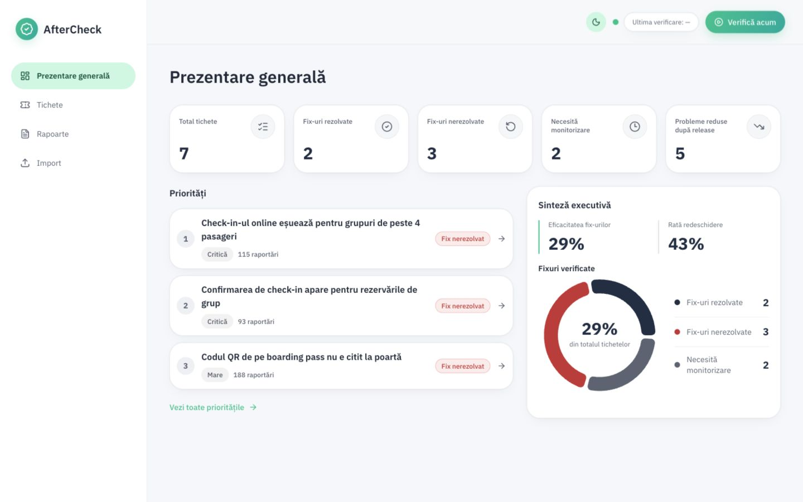
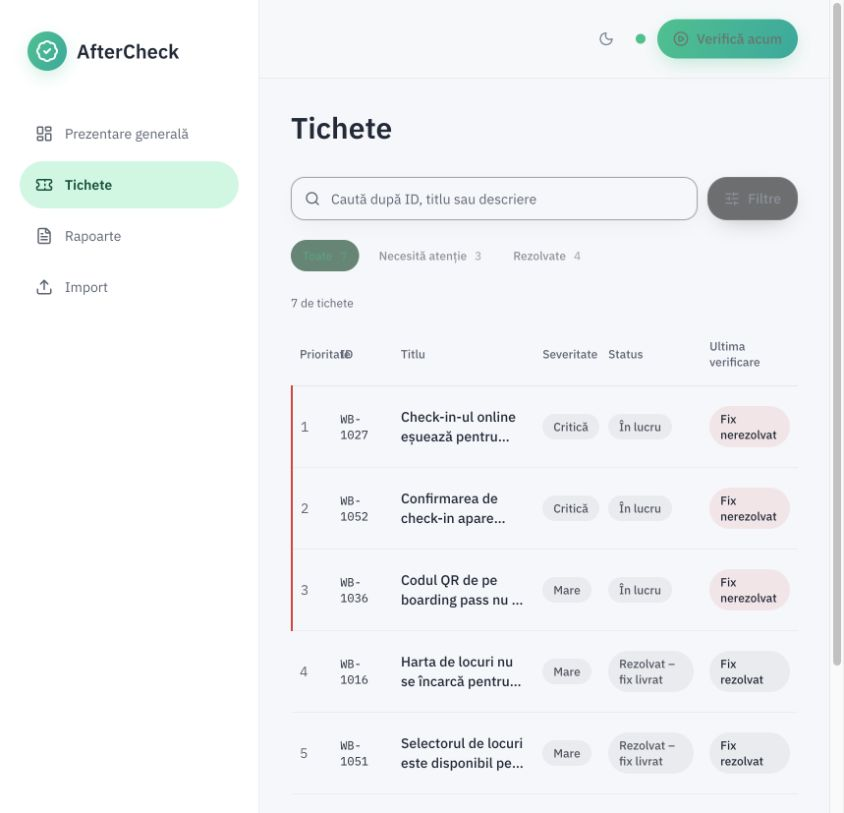
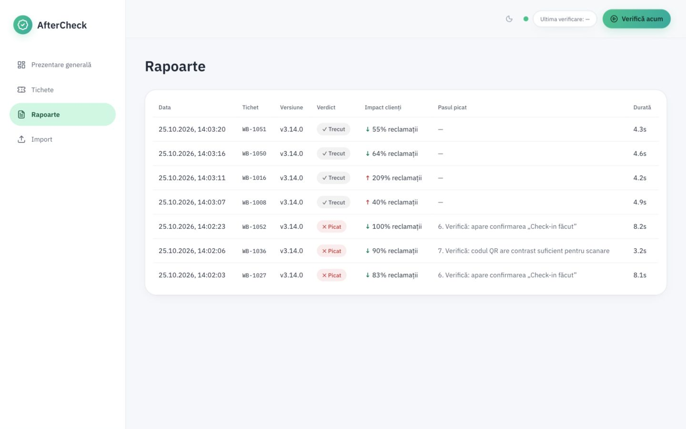
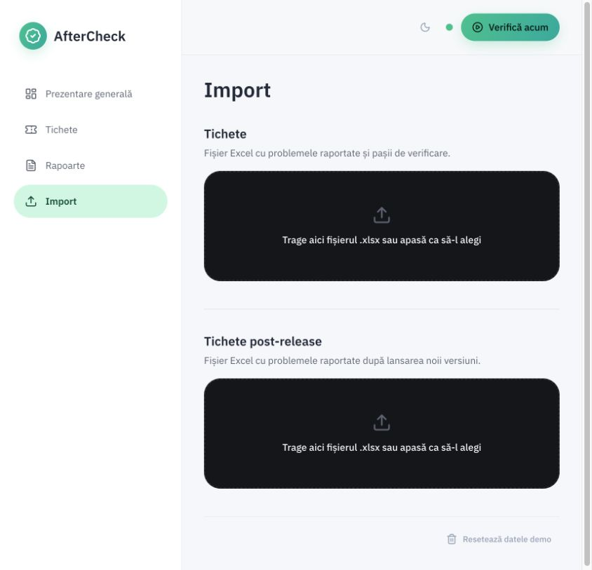
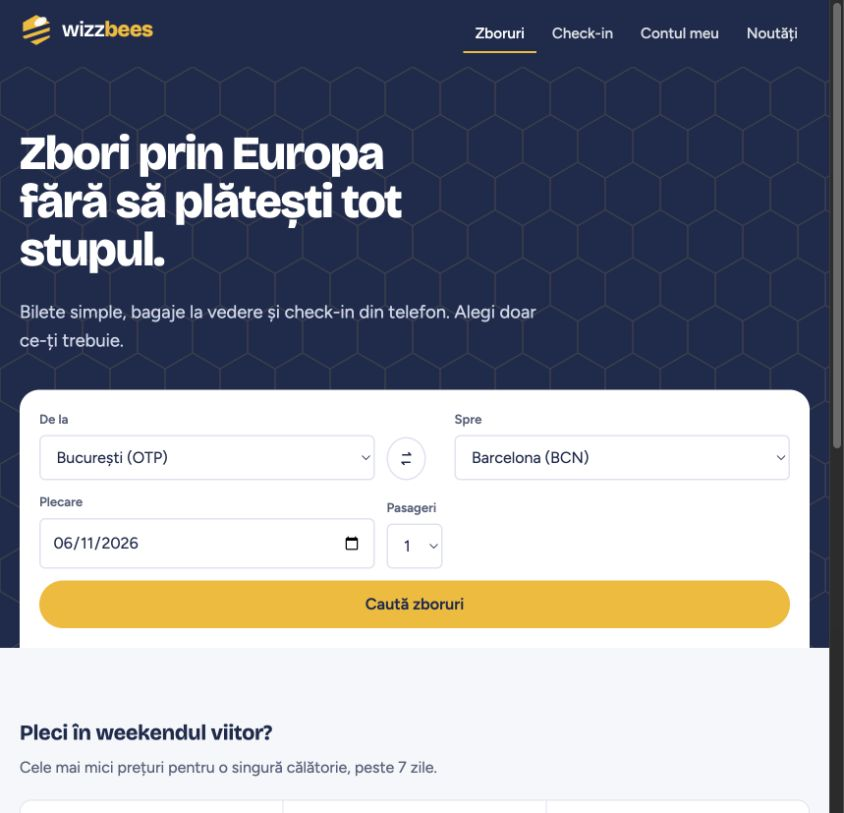

# AfterCheck

AfterCheck is a post-release verification prototype developed during the **ITFest x Innovation Labs hackathon**. It helps product teams answer a simple question:

> Did the delivered fix only pass a technical test, or did it actually solve the customer's problem?

The prototype combines automated browser checks with the evolution of customer-reported issues after a release. The current dataset is demonstrative, and **WizzBees is a fictional application used only as a testing environment**.

## Screenshots

### Dashboard



### Ticket overview



### Post-release reports



### Import flow



### WizzBees demo application



## How it works

1. Import the initial ticket batch from Excel.
2. Click **Verifică acum** to run the Playwright verification agent.
3. Review the generated technical reports.
4. Import the post-release ticket batch.
5. Click **Verifică acum** again.
6. AfterCheck associates the new reports with the initial issues and classifies each fix as:
   - **Rezolvat** — the technical test passed and reports decreased;
   - **Nerezolvat** — the Playwright test failed;
   - **Necesită monitorizare** — the test passed, but reports remained stable or increased.

## Architecture

```text
Initial tickets (.xlsx)
          ↓
FastAPI + SQLite
          ↓
Gemini-assisted planning + Playwright
          ↓
WizzBees demo application
          ↓
Technical reports
          ↓
Post-release tickets (.xlsx)
          ↓
Combined technical and customer-impact verdict
          ↓
React dashboard
```

## Repository structure

```text
frontend/       React, TypeScript, TanStack Query and Recharts dashboard
backend/        FastAPI, SQLite, Gemini and Playwright API
wizz-bees/      Fictional web application used by the verification agent
sample-data/    Initial and post-release demo Excel files
```

## Run locally

### 1. WizzBees

```bash
cd wizz-bees
npm install
npm run dev
```

WizzBees runs at `http://localhost:5173`.

### 2. Backend

```bash
cd backend
python -m venv .venv
source .venv/bin/activate
pip install -r requirements.txt
playwright install chromium
cp .env.example .env
uvicorn app.main:app --reload --port 8000
```

Gemini is optional. Without an API key, the application uses deterministic fallbacks.

### 3. Frontend

```bash
cd frontend
npm install
cp .env.example .env.local
npm run dev -- --port 3000
```

Open `http://localhost:3000`.

## Demo files

Use the files in `sample-data/` in this order:

1. `tichete-initiale.xlsx`
2. `tichete-post-release.xlsx`

The second import does not start the verification automatically. Results become available only after clicking **Verifică acum**.

## Main API endpoints

| Method | Endpoint | Purpose |
|---|---|---|
| `POST` | `/api/import` | Import initial tickets |
| `POST` | `/api/post-release-tickets/import` | Import post-release tickets |
| `POST` | `/api/verify/run` | Start manual verification |
| `GET` | `/api/verify/status` | Read verification status |
| `GET` | `/api/reports` | Read technical reports |
| `GET` | `/api/post-release-impact` | Read combined post-release results |
| `GET` | `/api/stats` | Read dashboard KPIs |

## Tests

```bash
cd backend
.venv/bin/python -m unittest discover -s tests -v

cd ../frontend
npm test
npm run build
```

## Prototype limitations and next steps

- Demo tickets and report counts are mock data, not Wizz Air data.
- Excel acts as the prototype integration layer.
- A production version could integrate with Jira, Linear, Azure DevOps, customer-support tools and CI/CD release events.
- SQLite can be replaced with PostgreSQL, while Playwright jobs can be distributed through a task queue.
- Semantic matching can be expanded with a vector database and human review for uncertain associations.

Built as a hackathon prototype focused on closing the loop between a technical fix and its real customer impact.

